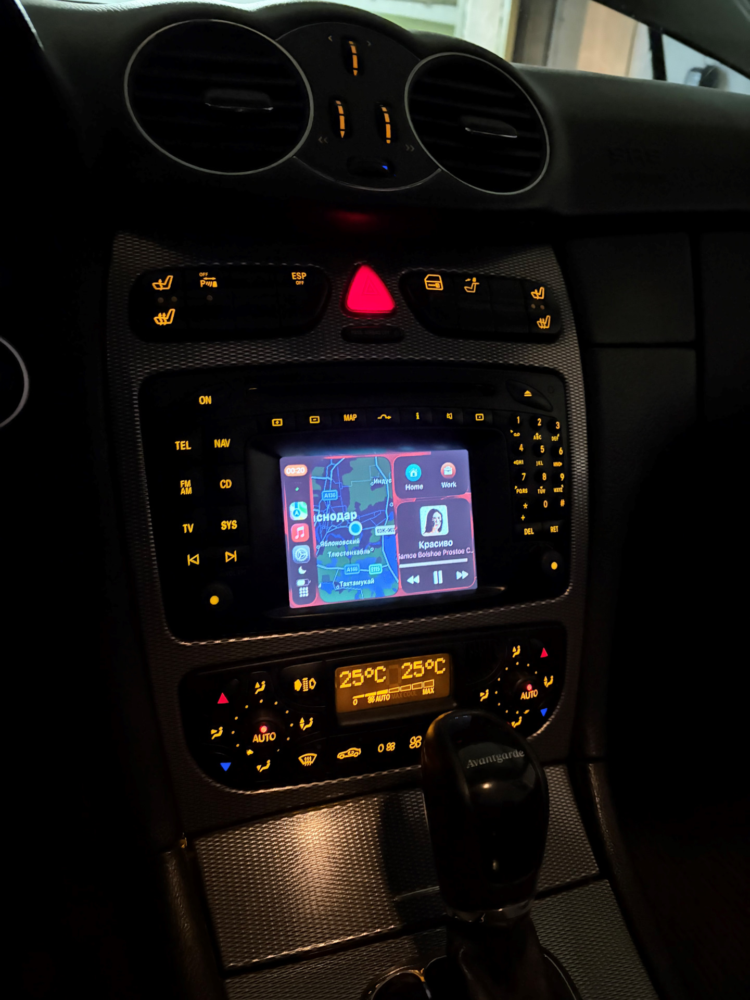
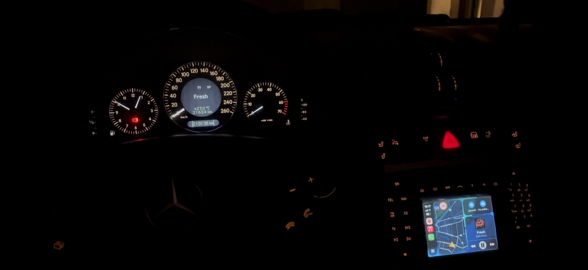

# Open TV for COMAND 2.0 or 2.5

This emulator TV tuner for Mercedes (Bosch) COMAND 2.0 or 2.5 for Carplay and AndroidAuto integration or other applications

<p align="center">
  
</p>


## What is it

This emulator work over [MKS CANable V1.0](https://github.com/makerbase-mks/CANable-MKS), initializes TV mode and forwards the pressing of buttons on the panel to usb via HID keyboard

### How to use?

1) Install the BOOT jumper on CANable 1.0 
2) Open [DfuSeDemo ](https://www.st.com/en/development-tools/stsw-stm32080.html) (DFU USB device firmware upgrade)
3) Select in "firmwire" folder .dfu file
4) Connect CANable 1.0 via USB
5) Upgrade CANable 1.0
4) Disconnect CANable 1.0 
6) Remove BOOT jumper
7) Connect CAN from COMAND (Connector C2, Pin 17, 18) and plug USB in PC
8) Use it! Press keyboard on comand for action on PC


### Table bends key COMAND - HID

| COMAND CAN key | HID key D-pad mode (default)*| HID key numeric mode* | Long press function** |
|----------------|:---------------------------:|:--------------------:|:-------------------:|
| 0 | KEY_KP0    |  KEY_KP0  |
| 1 | KEY_KP1    |  KEY_KP1  |
| 2 | KEY_UP     |  KEY_KP2  |
| 3 | KEY_KP3    |  KEY_KP3  |
| 4 | KEY_LEFT   |  KEY_KP4  |
| 5 | KEY_ENTER  |  KEY_KP5  | toogle key mode |
| 6 | KEY_RIGHT  |  KEY_KP6  |
| 7 | KEY_KP7    |  KEY_KP7  |
| 8 | KEY_DOWN   |  KEY_KP8  |
| 9 | KEY_KP9    |  KEY_KP9  |
| * | KEY_KPASTERISK |  KEY_KPASTERISK  | open sound setting for TV |
| # | KEY_KPDOT      |  KEY_KPDOT       |
| Back     | KEY_B |  KEY_B  |
| Forward  | KEY_N |  KEY_N  |
| Back Steering Wheel Key     | KEY_B |  KEY_B  |
| Forward Steering Wheel Key  | KEY_N |  KEY_N  |
| Press encoder | KEY_ENTER |  KEY_ENTER  |
| RET  | KEY_BACKSPACE |  KEY_BACKSPACE  |
| Encoder + rotary  | KEY_KPPLUS |  KEY_KPPLUS  |
| Encoder - rotary  | KEY_KPMINUS |  KEY_KPMINUS  |
| Open TV mode***     | KEY_F1 |  KEY_F1  |
| Close TV mode***    | KEY_F2 |  KEY_F2  |
| On background sound | KEY_F1 |  KEY_F1  |
| Mute                | KEY_F2 |  KEY_F2  |
| UNMute (same key)   | KEY_F1 |  KEY_F1  |
| Power off  | KEY_F5 |  KEY_F5  |

*hex HID code see in Open TV COMAND/Core/Inc/usb_hid_keys.h

**Press and hold the button for more than 5 seconds

***Pressing the TV button and any other

## ASCII text - USB CDC-ACM - COMAND - IC 

If your dashboard supports the output of data from commands, you can output up to 8 characters of text, send from 0 to 8 characters without any additional characters, more than 8 characters will be discarded, the first 8 will be displayed

Open the CDC-ACM in your OS and send the string 

<p align="center">
  
</p>

### LiviToSerial script

A lightweight Python script designed for Linux-based In-Vehicle Infotainment (**LIVI**) systems. It provides bidirectional communication via a serial port (`/dev/ttyACM0`) to synchronize media metadata with **COMAND** head units via CAN bus bridges) and log incoming diagnostic data.

### Features LiviToSerial script

- **ASCII Transcoding**: Transliterates non-ASCII track metadata on the fly using `unidecode` for hardware compatibility.
- **Dynamic Text Scrolling**: Automatically scrolls track titles longer than 8 characters with a configurable initial pause and smooth scrolling speed.
- **Bidirectional CAN-to-USB Bridging** – Processes high-density raw CAN bus frames from the STM32 controller asynchronously using non-blocking I/O (`os.O_NONBLOCK`) to prevent data frame drops or corruption. Logs real-time incoming data streams into a structured JSON file (cardata.json) for downstream system diagnostics.
- **LIVI Telemetry REST API Integration** – Maps decoded hex sequences directly into localized JSON payloads and dispatches them to the LIVI core state engine over low-latency HTTP POST requests.
-  **Automated Parking Camera Trigger** – Monitors `ID 0448` (COMAND to Navi) in real-time, instantly pushing `reverse: true` and `gear: "R"` vectors to open the backup camera view across the entire main screen on reverse gear engagement.
-  **Day/Night & Dimmer Sync** – Parses `ID 0464` (COMAND to TV) to extract physical photocell light sensor state and dashboard dimming wheel values, automatically switching CarPlay/Android Auto maps and LIVI UI between Light and Dark themes.


### Install LiviToSerial script

```
sudo apt install python3-unidecode
sudo wget https://github.com/niz93/Open-TV-COMAND/raw/refs/heads/main/LIVI%20integration/LiviToSerial.py
sudo chmod +x ~/LiviToSerial.py
cd /etc/systemd/system/
sudo wget https://github.com/niz93/Open-TV-COMAND/raw/refs/heads/main/LIVI%20integration/LiviToSerial.service
sudo systemctl enable LiviToSerial.service
```

## Switch to DFU from CDC-ACM STM32 

The project includes switch to DFU bootloader from CDC-ACM STM32

### How to use switch to DFU STM32

Open the CDC-ACM in your OS and send the `"DFU_BOOT"` string 

When the STM32 enters DFU mode, the board returns `"DFU_BOOT_OK"` and the host detects the USB device (0483:df11), which enumerates as a USB DFU Device.

## Automated DFU STM32 flash update from Linux  

The project includes an automated deployment script `flash_stm32.sh` to update the STM32 microcontroller firmware directly from a Linux host (e.g., Raspberry Pi or Orange Pi) without manual hardware jumper switching.

### Features DFU STM32 update
* **Automated Service Management:** Safely stops the `LiviToSerial.service` background sync tool before flashing and automatically restarts it after completion.
* **CDC-ACM Soft Trigger:** Sends a `DFU_BOOT` command over the virtual serial port (`/dev/ttyACM0`) to smoothly switch the microchip from normal emulator mode into the STMicroelectronics internal DFU bootloader.
* **Smart Mode Detection:** Checks if the device is already in DFU mode to skip the trigger phase, preventing errors if a previous flash cycle failed.
* **Verification & Safety Check:** Validates firmware file presence, checks for proper USB enumeration via a polling loop, and verifies successful service deployment using systemd.

### Prerequisites DFU STM32 flash
Ensure `dfu-util` is installed on your host system:
`sudo apt-get install dfu-util`

Download and make executable flash_stm32.sh
```
sudo wget https://raw.githubusercontent.com/niz93/Open-TV-COMAND/refs/heads/main/LIVI%20integration/flash_stm32.sh
chmod ./flash_stm32.sh
```

### How to Run DFU STM32 flash

Download Open TV COMAND.bin in your "home/pi" directory from releases and run flash script:

`./flash_stm32.sh`


### Script Environment Configuration
Before executing, ensure the following parameters inside `flash_stm32.sh` match your system paths:
* `PORT`: Path to the virtual COM port (Default: `/dev/ttyACM0`)
* `FIRMWARE_BIN`: Absolute path to your compiled pure binary file (Default: `/home/pi/Open TV COMAND.bin`)
* `SERVICE_NAME`: The systemd service to manage (Default: `LiviToSerial.service`)


## Support

For support, email 193niz@gmail.com or  [drive2](www.drive2.ru/users/niz/) 

## License

Open-TV-COMAND is free software, licensed under the **GNU General Public License v3.0 or later** (`GPL-3.0-or-later`). See [LICENSE](LICENSE) for the full text.

Under section 7(b) of the GPL, [NOTICE](NOTICE) adds one term: works based on Open-TV-COMAND, including ports to other languages, keep the attribution "Based on Open-TV-COMAND by Mitsuk Nickita".

Copyright (C) 2026 Mitsuk Nickita

You are free to use, study, share, and modify Open-TV-COMAND. If you distribute it or a modified version, you must pass on the same freedoms and make the corresponding source available under the GPL. It comes with NO WARRANTY, to the extent permitted by law.
